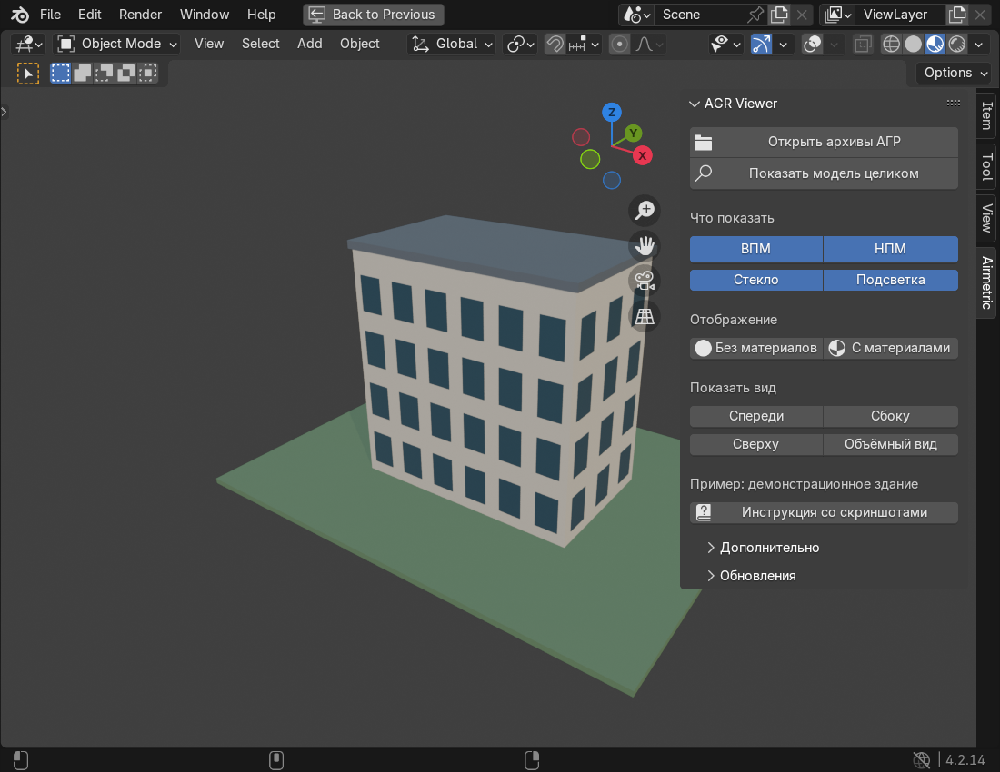

# Airmetric AGR Viewer

**Стабильная версия: 0.1.0.**

Плагин для просмотра архивов АГР в Blender. Открывает ВПМ и НПМ в текущей сцене,
показывает материалы, стекло и подсветку. Подходит для просмотра без опыта
моделирования: основные действия собраны в одной русской панели с подсказками.

- Blender **4.2 или новее**.
- Панель: **окно 3D → N → Airmetric → AGR Viewer**.
- Сохранять сцену перед загрузкой не требуется.

**[Скачать последнюю стабильную версию](https://github.com/XIV-gate/airmetric-agr-viewer/releases/latest)**
· [Версия 0.1.0](https://github.com/XIV-gate/airmetric-agr-viewer/releases/tag/v0.1.0)
· [Все версии](https://github.com/XIV-gate/airmetric-agr-viewer/releases)
· [Инструкция](docs/USER_GUIDE_RU.md)
· [Сообщить об ошибке](https://github.com/XIV-gate/airmetric-agr-viewer/issues)

## Установка и обновление

1. Откройте страницу релиза и скачайте из **Assets** файл
   **airmetric_agr_viewer-0.1.0.zip**. Распаковывать его не нужно.
   **Source code.zip** и **Source code.tar.gz** для установки не подходят.
2. В Blender выберите **Edit → Preferences → Add-ons → меню → Install from Disk…**.
3. Выберите ZIP целиком и включите **Airmetric AGR Viewer**.
4. Наведите мышь на окно 3D, нажмите **N** и откройте вкладку **Airmetric**.

Для дальнейших обновлений разверните **«Обновления» → «Проверить обновления»**,
выберите опубликованную версию и нажмите **«Установить выбранную версию»**.
После установки сохраните сцену и перезапустите Blender. Вход в аккаунт не нужен;
доступ в интернет должен быть разрешён в настройках Blender.

## Быстрый запуск

1. Нажмите **«Открыть архивы АГР»**.
2. Выберите один или несколько ZIP и подтвердите открытие.
3. Включите **ВПМ** или **НПМ** и нажмите **«Показать модель целиком»**.
4. Нажмите **«С материалами»** для просмотра текстур или **«Без материалов»**
   для быстрого просмотра формы.

Можно выбрать общий ZIP с вложенными AGR-архивами: плагин откроет их сам.
Существующие объекты остаются в сцене; повторное открытие архива добавляет копию.

## Отображение и навигация

| Кнопка | Действие |
|---|---|
| **ВПМ / НПМ** | Два независимых переключателя детальной и упрощённой модели |
| **Стекло / Подсветка** | Показ или скрытие соответствующих объектов |
| **Показать модель целиком** | Возврат видимых загруженных моделей в центр экрана |
| **Без материалов / С материалами** | Быстрый просмотр формы или просмотр с текстурами |
| **Спереди / Сбоку / Сверху** | Взгляд с выбранной стороны |
| **Объёмный вид** | Взгляд под углом в перспективе |

Наведите мышь на кнопку, чтобы прочитать подсказку. Для сравнения ВПМ и НПМ
удобнее включать их по очереди, чтобы поверхности не накладывались.

## Текстуры и сохранение

Текстуры встраиваются в данные Blender. После загрузки собственная временная
распаковка удаляется, исходные ZIP остаются без изменений.
Чтобы открыть результат позже, сохраните сцену через **Ctrl + Shift + S**.
Плагин не сохраняет сцену за вас.

## Инструкция и помощь

- [Пошаговая инструкция](docs/USER_GUIDE_RU.md)
- [Если что-то не получилось](docs/USER_GUIDE_RU.md#если-что-то-не-получилось)
- [Все установочные версии](https://github.com/XIV-gate/airmetric-agr-viewer/releases)

Для сообщения об ошибке достаточно версий Blender и плагина, описания действий
и текста ошибки. Не публикуйте закрытые рабочие архивы и персональные пути.
