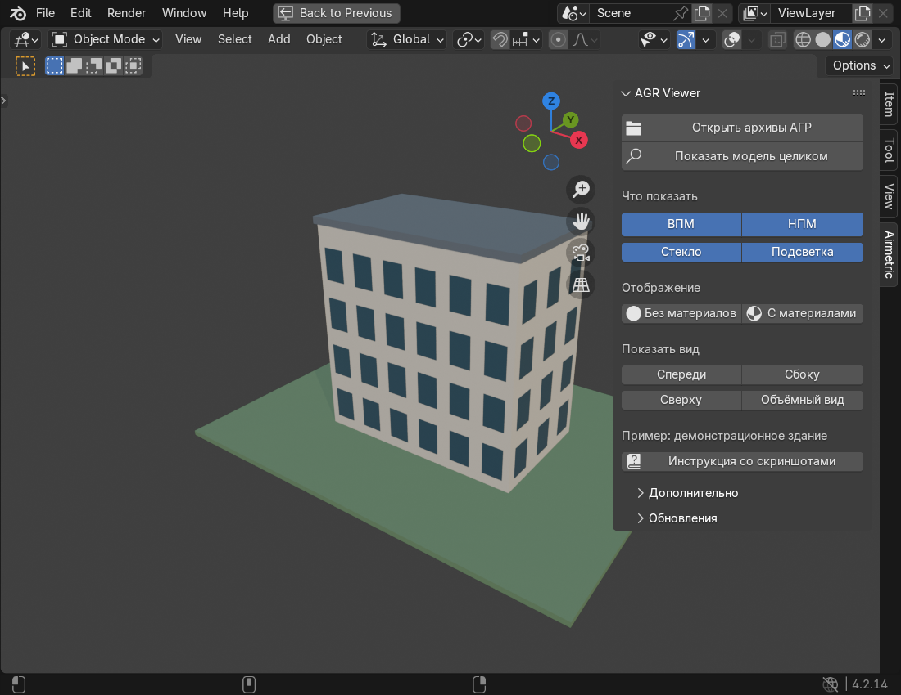

# Как пользоваться Airmetric AGR Viewer

Не нужно разбираться в моделировании. Достаточно установить плагин, выбрать
архивы и нажимать подписанные кнопки. На иллюстрациях — учебное здание;
его нет внутри установочного ZIP.

## 1. Установите плагин один раз

1. Получите файл **airmetric_agr_viewer-0.1.0.zip**. Не распаковывайте его.
2. Откройте Blender версии 4.2 или новее.
3. В верхнем меню выберите **Edit → Preferences** («Правка → Настройки»).
4. Откройте раздел **Add-ons** («Дополнения»).
5. Нажмите маленькую стрелку меню справа сверху и выберите **Install from Disk…**
   («Установить с диска»). В некоторых версиях кнопка называется **Install…**.
6. Укажите полученный ZIP и подтвердите установку.
7. Найдите **Airmetric AGR Viewer** и поставьте галочку слева от названия.
8. Закройте окно настроек.

Для установки нужен именно установочный ZIP из **[Releases](https://github.com/XIV-gate/airmetric-agr-viewer/releases)**.
Файлы **Source code** для установки не подходят.

## 2. Найдите вкладку Airmetric

Наведите указатель на большое окно с 3D-сценой и нажмите латинскую **N**.
Справа появится боковая панель. Нажмите вертикальную вкладку **Airmetric**.

Если панель уже была открыта, клавиша N её закроет — нажмите N ещё раз.
Если надписи тесно стоят, потяните левый край панели влево, чтобы расширить её.

## 3. Откройте архивы АГР

1. Нажмите большую кнопку **«Открыть архивы АГР»**.
2. Найдите папку с вашими ZIP.
3. Выберите один архив или несколько. Для нескольких удерживайте **Ctrl** и
   нажимайте на нужные файлы; **A** в списке файлов выделяет все подходящие файлы.
4. Подтвердите открытие кнопкой в файловом окне.
5. Подождите окончания загрузки и подготовки материалов.

Можно загрузить ВПМ и НПМ вместе или по отдельности. Участок и здания обычно
хранятся в отдельных архивах — выберите все нужные. Сохранять новую сцену заранее
не требуется. Повторное открытие того же архива добавляет ещё одну копию.
Если вам прислали один общий ZIP с вложенными AGR-архивами, выберите только
этот общий ZIP: плагин сам откроет вложенные комплекты.

Просмотрщик добавляет модели к сцене. Если нужен чистый просмотр, сначала
создайте новый файл через **File → New → General** и удалите стандартный куб:
выделите его и нажмите **X**, затем подтвердите удаление.

## 4. Выберите ВПМ или НПМ

В разделе **«Что показать»** находятся два независимых переключателя:

| Кнопка | Что показывает |
|---|---|
| **ВПМ** | Детальную высокополигональную модель |
| **НПМ** | Упрощённую низкополигональную модель |
| **Стекло** | Остекление включённых моделей |
| **Подсветка** | Геометрию архитектурной подсветки |

Синяя кнопка означает «включено», серая — «выключено». Для сравнения удобнее
включать ВПМ и НПМ по очереди: одновременно они могут накладываться друг на друга.
Отключение ВПМ не переключает НПМ, и наоборот.

Стекло и подсветка показываются, если они присутствуют в архиве отдельными
объектами. Кнопка не создаёт подсветку, которой нет в модели.

Наведите мышь на переключатель и немного подождите — увидите подсказку.

## 5. Рассмотрите модель

**«Показать модель целиком»** возвращает видимые загруженные модели в центр
экрана. Нажмите её, если модель потерялась при вращении или приближении.

**«С материалами»** показывает цвета, текстуры и стекло.

**«Без материалов»** показывает форму однотонными поверхностями. Используйте
его, если компьютер медленно отображает большую модель.

Кнопки **«Спереди», «Сбоку», «Сверху»** показывают модель без перспективных
искажений. **«Объёмный вид»** возвращает взгляд под углом.

- Вращать: зажмите **среднюю кнопку мыши** и двигайте мышь.
- Приблизить или отдалить: вращайте **колёсико**.
- Сдвинуть вид: удерживайте **Shift + среднюю кнопку мыши**.

Ориентация «Спереди» определяется осями модели и может не совпасть с главным
фасадом здания. Эти кнопки меняют только взгляд, а не положение объектов.

## 6. Сохраните результат, если он нужен позже

Нажмите **Ctrl + Shift + S**, выберите имя и место для файла `.blend`.
Текстуры уже встроены в сцену. Распакованная копия ZIP после загрузки удалена,
но ваш исходный ZIP остался на месте.

Несохранённая сцена находится только в памяти: чтобы не потерять её при закрытии
Blender, сохраните файл. Плагин не сохраняет сцену за вас.

## 7. Обновите плагин

1. Разверните **«Обновления»** маленькой стрелкой слева от названия.
2. Нажмите **«Проверить обновления»** и дождитесь списка.
3. Выберите нужную версию. Можно выбрать более новую или вернуться к предыдущей.
4. Нажмите **«Установить выбранную версию»**.
5. Прочитайте номер версии в окне подтверждения и подтвердите установку.
6. Дождитесь сообщения об успешной установке.
7. **Сохраните сцену**, закройте Blender и откройте его снова.

Предварительные версии помечены отдельно. По умолчанию выбирается последняя
стабильная версия. Самообновление работает у установленного плагина; папка
с Git-исходниками защищена от перезаписи.

Для получения списка нужен интернет, разрешённый в настройках Blender.
Вход в аккаунт не требуется. Если у вас уже установлена последняя версия,
обновлять ничего не нужно: кнопка установки этой же версии будет недоступна.
Сразу после публикации список может обновиться с небольшой задержкой.

## Если что-то не получилось

| Что видно | Что сделать |
|---|---|
| Нет вкладки Airmetric | Проверьте галочку плагина в Add-ons и нажмите N именно над окном 3D |
| Модель не видна | Включите нужный переключатель ВПМ/НПМ и нажмите «Показать модель целиком» |
| Поверхности мерцают | Оставьте включённым только ВПМ или только НПМ; проверьте, не загрузили ли архив дважды |
| Материалы долго появляются | Подождите подготовки шейдеров или временно выберите «Без материалов» |
| ВПМ не загрузилась из-за GeoJSON/текстур | Выберите исходный полный AGR-архив с FBX, GeoJSON и текстурами |
| Открытие недоступно при редактировании | Нажмите Tab, чтобы выйти из режима редактирования объекта |
| Обновление недоступно | Проверьте интернет; если выбранная версия уже установлена, обновлять ничего не нужно |

При ошибке загрузки плагин убирает данные неудачной операции и показывает
причину под кнопками. Исходные архивы он не меняет.
